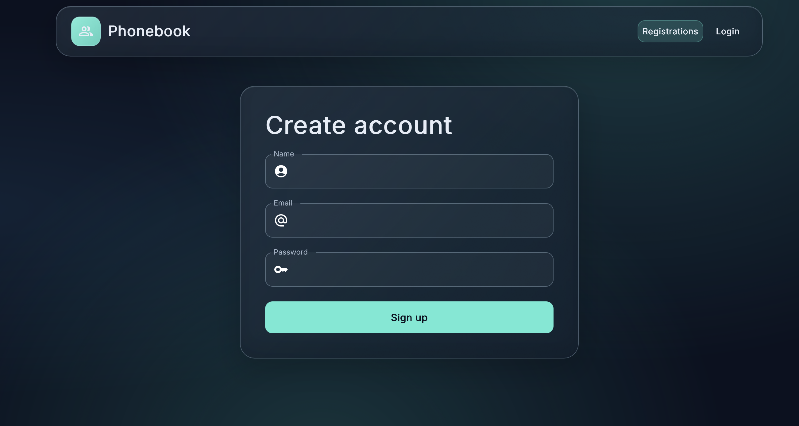
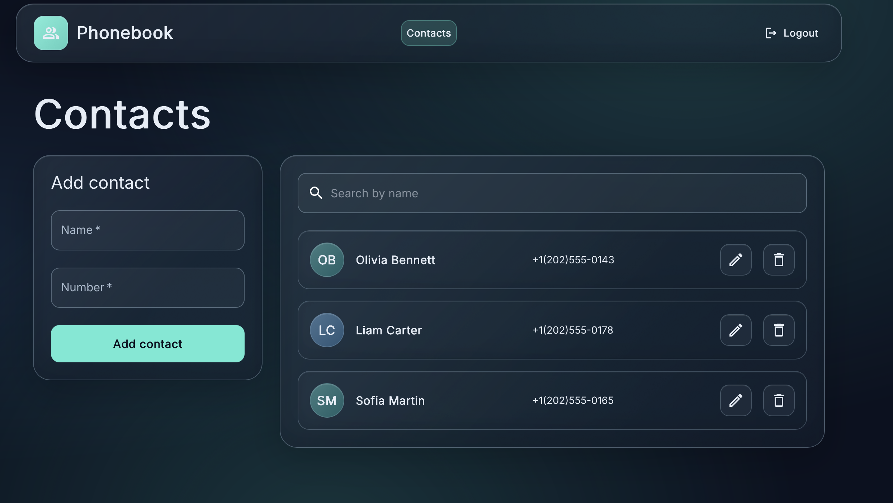

# Phonebook

A responsive contact management app built with React. Create an account, sign in, and manage your personal contacts from one place.

**[Open the live app](https://AnSh202302.github.io/goit-react-hw-08-phonebook/)**

## Screenshots

### Registration



### Contacts



## Features

- Create an account and sign in.
- Add, edit, and delete contacts.
- Search contacts by name.
- Get feedback for loading, empty, and error states.
- Use the responsive interface on desktop and mobile screens.

## Built with

- React
- Redux Toolkit and React Redux
- React Router
- Material UI
- Axios
- Vite
- Vitest and Testing Library

The app uses the GoIT Connections API to authenticate users and store contacts.

## Getting started

Clone the repository and open its project directory. Then install dependencies and start the development server:

```bash
npm install
npm run dev
```

Open the local URL printed in the terminal.

## Tests and production build

Run the test suite:

```bash
npm test
```

Run ESLint:

```bash
npm run lint
```

Create a production build:

```bash
npm run build
```
